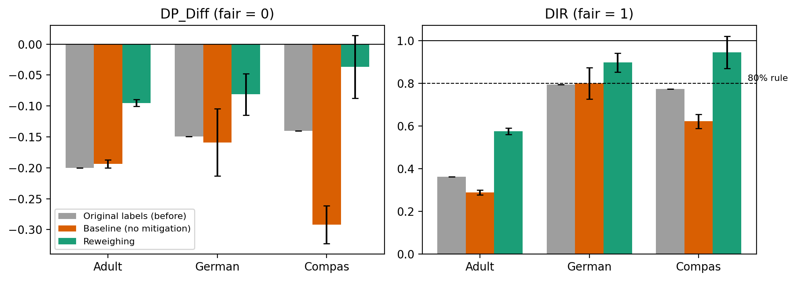

# Reweighing for Fair Classification – Evaluation on Adult, German Credit and COMPAS

Code for Assignment 4 (Algorithmic Fairness). It evaluates the **Reweighing** pre-processing algorithm of
F. Kamiran and T. Calders, *Data preprocessing techniques for classification without discrimination*,
Knowledge and Information Systems 33(1), 1–33, 2012.

## What the notebook does
1. Loads three benchmark datasets and defines a binary protected attribute and a binary favourable label.
2. **Before mitigation:** computes DP_Diff, Disparate Impact Ratio (DIR) and Consistency on the original labels.
3. Makes a stratified 70/30 train/test split (stratified jointly on label and protected group).
4. Fits Reweighing on the training split only: W(s, y) = P(s)·P(y) / P(s, y).
5. Trains logistic regression with the weights as `sample_weight`, plus an unweighted baseline.
6. **After mitigation:** reports DP_Diff, DIR, Consistency, accuracy, balanced accuracy and F1 on the test set.
7. Repeats the split with 5 seeds, reports mean ± std, and plots a before/after comparison.

Reweighing and the metrics are implemented directly from their definitions (the metrics follow AIF360). A built-in test checks the weights on a small example with a known answer, and the pipeline asserts that the weighted training data has DP_Diff = 0.

## Datasets
The data files are not included in this repository. Download them and place them in a `data/` folder:

| Dataset | File | Source | Protected attribute (privileged) | Favourable label |
| --- | --- | --- | --- | --- |
| Adult | `adult.csv` | UCI Adult / Kaggle "Adult Census Income" (CSV with header) | sex (male) | income > 50K |
| German Credit | `statlog+german+credit+data/german.data` | UCI Statlog (German Credit Data), id 144 | age > 25 | good credit |
| COMPAS | `propublica_data_for_fairml.csv` | ProPublica COMPAS data, FairML version (Kaggle "COMPAS Recidivism Racial Bias") | race (non-African-American) | no two-year recidivism |

Expected layout:
```
data/
  adult.csv
  propublica_data_for_fairml.csv
  statlog+german+credit+data/german.data
```

## How to run
```bash
pip install -r requirements.txt
export DATA_DIR=data
jupyter notebook Reweighing_Fairness_Evaluation.ipynb
```
On Databricks, `DATA_DIR` defaults to the workspace folder of the assignment. Runtime is under a minute on a laptop.

## Parameter settings
| Parameter | Value |
| --- | --- |
| Classifier | Logistic regression, L2, C = 1.0, lbfgs, max_iter = 2000 |
| Encoding | One-hot (categorical), standardisation (numerical), fitted on the training split |
| Split | 70/30, stratified on label × group |
| Seeds | 0, 1, 2, 3, 42 |
| Consistency | k = 5 nearest neighbours in the encoded feature space |
| Adult cleaning | rows with "?" removed (30,162 rows left); `education` and `fnlwgt` dropped |
| COMPAS features | `score_factor` (the COMPAS score) excluded |

## Results (test set, mean over 5 splits)
| Dataset | Stage | DP_Diff | DIR | Consistency | Accuracy |
| --- | --- | --- | --- | --- | --- |
| Adult | Original labels | −0.200 | 0.362 | 0.839 | – |
| | Baseline | −0.194 | 0.288 | 0.957 | 0.848 |
| | Reweighing | −0.095 | 0.575 | 0.959 | 0.842 |
| German | Original labels | −0.149 | 0.795 | 0.742 | – |
| | Baseline | −0.159 | 0.799 | 0.821 | 0.759 |
| | Reweighing | −0.081 | 0.897 | 0.819 | 0.755 |
| COMPAS | Original labels | −0.140 | 0.773 | 0.618 | – |
| | Baseline | −0.292 | 0.621 | 0.987 | 0.673 |
| | Reweighing | −0.037 | 0.945 | 0.986 | 0.660 |



## Repository contents
* `Reweighing_Fairness_Evaluation.ipynb` – the complete pipeline
* `requirements.txt` – Python dependencies
* `fairness_before_after.png` – figure produced by the notebook
